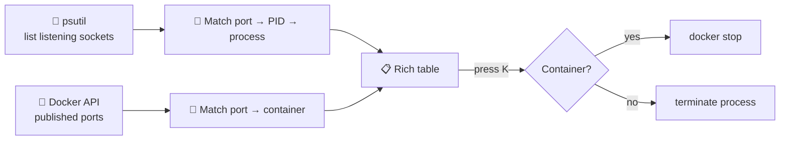

<div align="center">


<p>

<a href="https://github.com/HemashreeVI/portpilot/actions/workflows/ci.yml"></a>

</p>
<p>
<a href="https://pypi.org/project/portpilot-cli/"></a>


</p>

**[🌐 Website](https://hemashreevi.github.io/PortPilot/)** · **[⚡ Install](#-install)** · **[🕹️ Usage](#%EF%B8%8F-usage)** · **[🧭 How it works](#-how-it-works)** · **[🗺️ Roadmap](#%EF%B8%8F-roadmap)**

</div>

---

## 😤 The problem

You start your app and get:

```text
OSError: [Errno 98] Address already in use: ('0.0.0.0', 9092)
```

Then the usual hunt begins: `netstat -ano | findstr 9092`, copy a PID, open Task Manager, find nothing, and realise it's actually a **Docker container**, so you go and stop that too.

**PortPilot does all of that in one screen.**

## ✨ Features

<table>
<tr>
<td width="33%" align="center">🔎<br/><b>See every port</b><br/><sub>Port, PID, process name, user and uptime in one live table</sub></td>
<td width="33%" align="center">🐳<br/><b>Docker-aware</b><br/><sub>Shows <i>which container</i> owns a port, not just "com.docker.backend"</sub></td>
<td width="33%" align="center">⌨️<br/><b>One-key free</b><br/><sub>Select a row and press <kbd>K</kbd>. It stops the process or the container.</sub></td>
</tr>
<tr>
<td align="center">🎯<br/><b>Ask about one port</b><br/><sub><code>portpilot 9092</code> answers "who is on 9092?"</sub></td>
<td align="center">🛡️<br/><b>Safe by default</b><br/><sub>Asks before killing and refuses to touch system-critical processes</sub></td>
<td align="center">🖥️<br/><b>Cross-platform</b><br/><sub>PowerShell, macOS Terminal and Linux shells</sub></td>
</tr>
</table>

## 🕹️ Usage

```bash
portpilot              # live table of every listening port
portpilot 9092         # who is using port 9092?
portpilot kill 9092    # free port 9092 (asks first)
portpilot --docker     # only ports owned by Docker containers
```

<details>
<summary><b>All options</b></summary>

```bash
portpilot --list           # print the table once (no live view; also used when piping)
portpilot --json           # machine-readable output, e.g. for scripts
portpilot --json 9092      # one port as JSON
portpilot --udp            # include UDP sockets
portpilot kill 9092 -y     # don't ask
portpilot kill 9092 --force  # kill immediately instead of asking the process to exit
portpilot --version
```

`portpilot <port>` exits with **0** if the port is busy and **1** if it's free, so it works in scripts:
`portpilot 5432 || docker compose up -d db`

</details>

**Keys in the live view**

| Key | Action |
|---|---|
| <kbd>↑</kbd> <kbd>↓</kbd> | select a row |
| <kbd>K</kbd> | free the selected port (asks <kbd>y</kbd>/<kbd>N</kbd> first) |
| <kbd>D</kbd> | toggle "Docker only" |
| <kbd>/</kbd> | filter by port, name, container or hint |
| <kbd>R</kbd> | refresh now (it also refreshes every 2 s) |
| <kbd>Q</kbd> / <kbd>Esc</kbd> | quit |

**Example**

```text
PS> portpilot
PORT   PID     NAME            SOURCE
5432   1840    postgres        local
9092   7731    kafka           🐳 docker: kafka-1
8000   3022    uvicorn         local

PS> portpilot kill 9092
? Port 9092 belongs to container "kafka-1". Stop it? (y/N) y
✔ stopped container kafka-1 · port 9092 is free
```

**Live view** (real output: a Redis and an nginx container plus a local Python server)


**"Who is on 6379?"**


**Free a port held by a container**


## 🧭 How it works



### 🛡️ Safety rules

- Always asks before stopping anything (unless you pass `-y`).
- Never touches core OS processes: PID 0/1/4, `System`, `svchost.exe`, `lsass.exe`, `launchd`, `systemd`, `sshd` and friends, or PortPilot itself.
- Processes get a polite terminate first and are only force-killed if they don't exit within 3 s.
- Re-checks the process start time right before killing, so a recycled PID is never hit by mistake.
- Docker containers are stopped with `docker stop` (graceful), never by killing `docker-proxy` or Docker Desktop.

### 💻 Platform notes

| | Notes |
|---|---|
| **Windows** | Works in PowerShell and Windows Terminal. Run as Administrator to see owners of system services. Docker Desktop ports are traced to the container, not `com.docker.backend`. |
| **macOS** | Without `sudo`, macOS only shows your own processes. `sudo portpilot` shows everything. |
| **Linux** | Run with `sudo` to see other users' processes. Works with `docker-proxy` and rootless Docker. |

## ⚡ Install

```bash
pip install portpilot-cli
portpilot
```

> The PyPI package is **`portpilot-cli`** (the name `portpilot` belongs to a different project); the command you type is still `portpilot`.

**Straight from GitHub** (no PyPI needed)

```bash
pip install git+https://github.com/HemashreeVI/PortPilot.git
```

**From source**

```bash
git clone https://github.com/HemashreeVI/portpilot.git
cd portpilot
pip install -e .
portpilot
```

Requires Python 3.10+. Docker is optional; without it PortPilot simply shows local processes.

**Run the tests**

```bash
pip install -e ".[dev]"
pytest
```

## 🗂️ Project structure

```
portpilot/
├── portpilot/
│   ├── __main__.py     # command-line entry point
│   ├── scanner.py      # finds listening ports and their processes
│   ├── docker_map.py   # maps ports to Docker containers
│   ├── killer.py       # safely stops a process or container
│   ├── hints.py        # 5432 → PostgreSQL, 9092 → Kafka, …
│   └── ui.py           # Rich table and key handling
├── tests/              # 23 tests: real sockets, real kills, parsing, safety rules
├── docs/               # terminal screenshots
├── pyproject.toml
└── README.md
```

## 🗺️ Roadmap

- [x] **Step 1:** List all listening ports with PID and process name
- [x] **Step 2:** `portpilot <port>` lookup
- [x] **Step 3:** Map ports to Docker containers
- [x] **Step 4:** Safe kill (process or `docker stop`) with confirmation
- [x] **Step 5:** Live interactive TUI with one-key actions
- [x] *Stretch:* common-port hints (`5432 → PostgreSQL`)
- [x] *Bonus:* `--json` output and script-friendly exit codes
- [ ] *Stretch:* publish to PyPI (`pip install portpilot`)
- [ ] *Next:* Kubernetes `port-forward` and WSL awareness

## 🧰 Built with

<p align="center"></p>

---

<div align="center">

⭐ **If PortPilot saved you a port hunt, [star the repo](https://github.com/HemashreeVI/PortPilot)! It helps other developers find it.**

**Built by [Hemashree V I](https://hemashreevi.github.io)**, born from a real `localhost:9092` headache 🧭

<a href="https://hemashreevi.github.io"></a>
<a href="https://www.linkedin.com/in/hema-shree-373622289"></a>
<a href="mailto:shreejith2005@gmail.com"></a>

</div>
