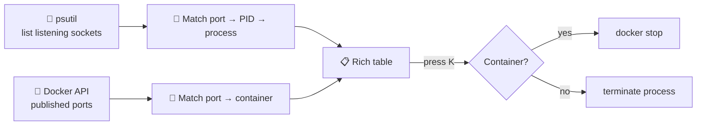

<div align="center">




<p>


</p>
<p>


</p>

**[⚡ Install](#-install)** · **[🕹️ Usage](#%EF%B8%8F-usage)** · **[🧭 How it works](#-how-it-works)** · **[🗺️ Roadmap](#%EF%B8%8F-roadmap)**

</div>

---

## 😤 The problem

You start your app and get:

```text
OSError: [Errno 98] Address already in use: ('0.0.0.0', 9092)
```

Then the usual hunt begins: `netstat -ano | findstr 9092`, copy a PID, open Task Manager, find nothing, and realise it's actually a **Docker container**, so you go and stop that too.

**PortPilot does all of that in one screen.**

## ✨ Features

<table>
<tr>
<td width="33%" align="center">🔎<br/><b>See every port</b><br/><sub>Port, PID, process name, user and uptime in one live table</sub></td>
<td width="33%" align="center">🐳<br/><b>Docker-aware</b><br/><sub>Shows <i>which container</i> owns a port, not just "com.docker.backend"</sub></td>
<td width="33%" align="center">⌨️<br/><b>One-key free</b><br/><sub>Select a row and press <kbd>K</kbd>. It stops the process or the container.</sub></td>
</tr>
<tr>
<td align="center">🎯<br/><b>Ask about one port</b><br/><sub><code>portpilot 9092</code> answers "who is on 9092?"</sub></td>
<td align="center">🛡️<br/><b>Safe by default</b><br/><sub>Asks before killing and refuses to touch system-critical processes</sub></td>
<td align="center">🖥️<br/><b>Cross-platform</b><br/><sub>PowerShell, macOS Terminal and Linux shells</sub></td>
</tr>
</table>

## 🕹️ Usage

```bash
portpilot              # live table of every listening port
portpilot 9092         # who is using port 9092?
portpilot kill 9092    # free port 9092 (asks first)
portpilot --docker     # only ports owned by Docker containers
```

**Example**

```text
PS> portpilot
PORT   PID     NAME            SOURCE
5432   1840    postgres        local
9092   7731    kafka           🐳 docker: kafka-1
8000   3022    uvicorn         local

PS> portpilot kill 9092
? Port 9092 belongs to container "kafka-1". Stop it? (y/N) y
✔ stopped container kafka-1 · port 9092 is free
```

> 🎬 *A terminal recording (GIF) goes here once the TUI is built.*

## 🧭 How it works



## ⚡ Install

```bash
git clone https://github.com/HemashreeVI/portpilot.git
cd portpilot
pip install -e .
portpilot
```

## 🗂️ Project structure

```
portpilot/
├── portpilot/
│   ├── __main__.py     # command-line entry point
│   ├── scanner.py      # finds listening ports and their processes
│   ├── docker_map.py   # maps ports to Docker containers
│   ├── killer.py       # safely stops a process or container
│   └── ui.py           # Rich table and key handling
├── tests/
├── pyproject.toml
└── README.md
```

## 🗺️ Roadmap

- [ ] **Step 1:** List all listening ports with PID and process name
- [ ] **Step 2:** `portpilot <port>` lookup
- [ ] **Step 3:** Map ports to Docker containers
- [ ] **Step 4:** Safe kill (process or `docker stop`) with confirmation
- [ ] **Step 5:** Live interactive TUI with one-key actions
- [ ] *Stretch:* publish to PyPI (`pip install portpilot`), common-port hints (`5432 → Postgres`)

## 🧰 Built with

<p align="center"></p>

---

<div align="center">

**Built by [Hemashree V I](https://hemashreevi.github.io)**, born from a real `localhost:9092` headache 🧭

<a href="https://hemashreevi.github.io"></a>
<a href="https://www.linkedin.com/in/hema-shree-373622289"></a>
<a href="mailto:shreejith2005@gmail.com"></a>

</div>
